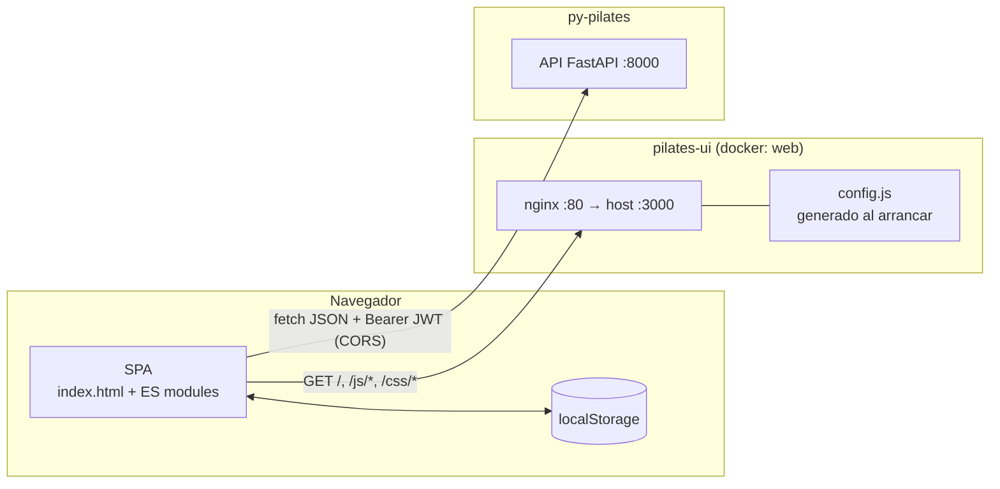
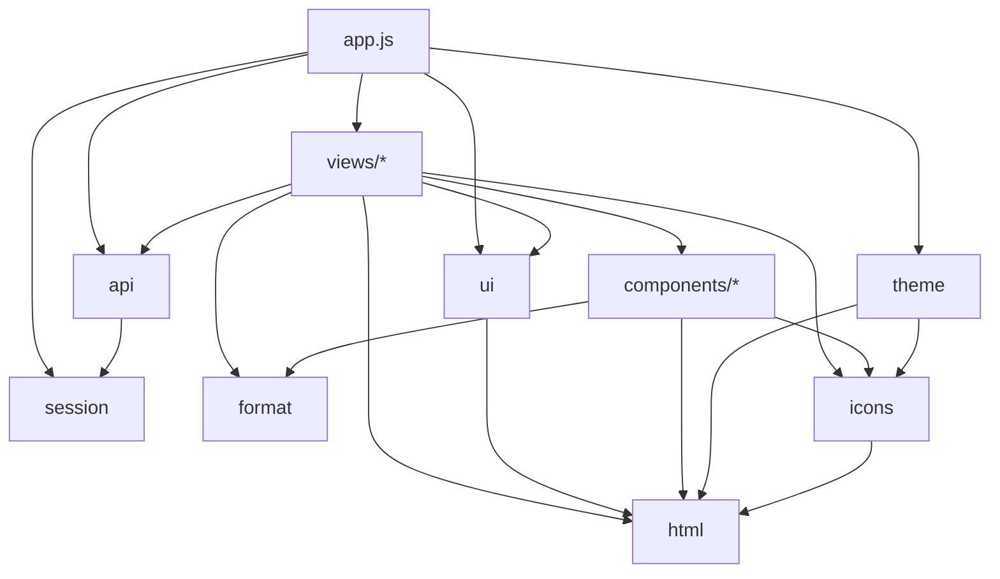
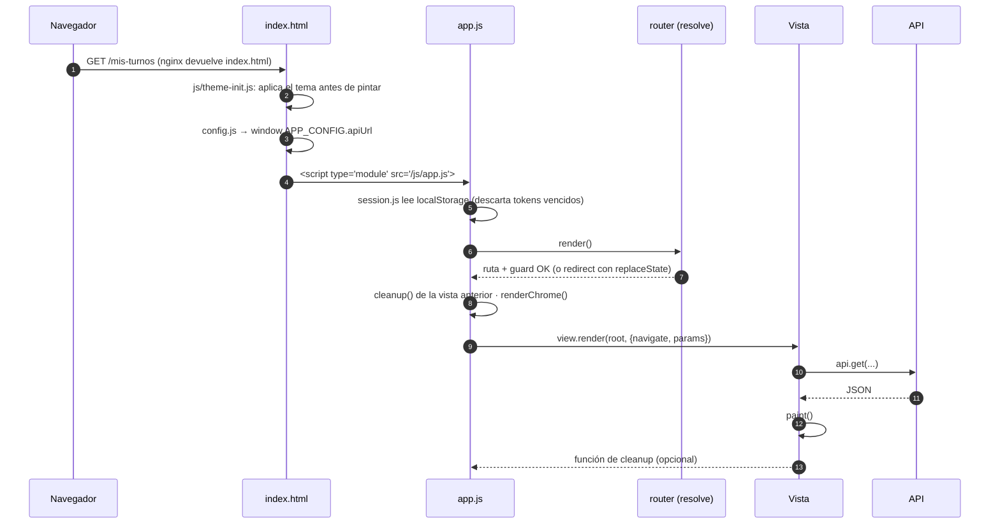
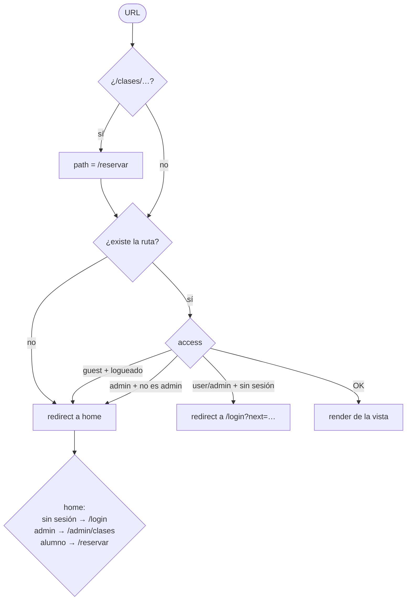
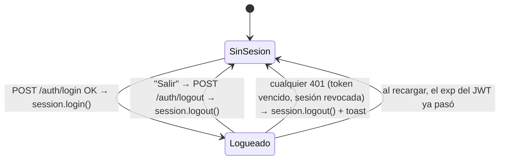
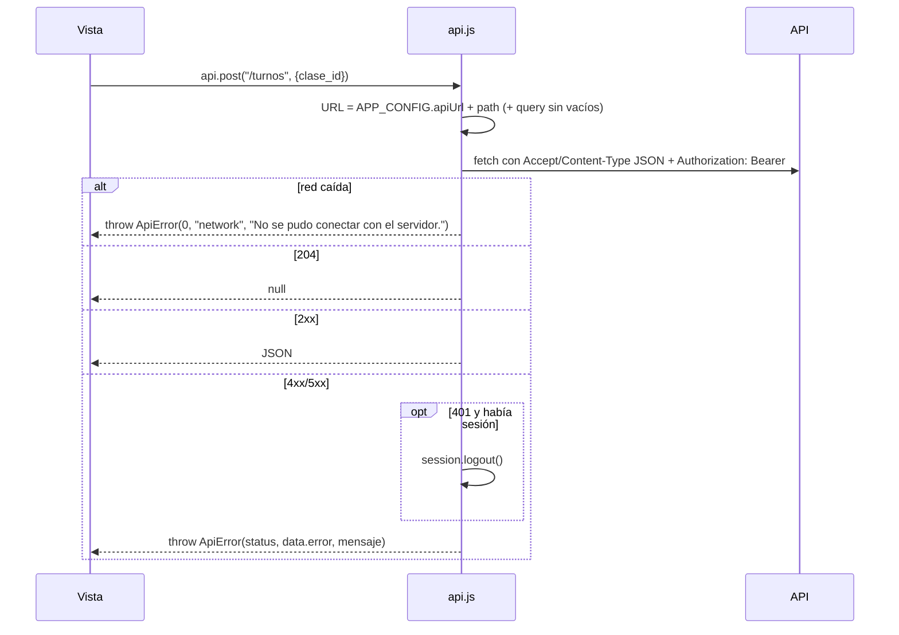
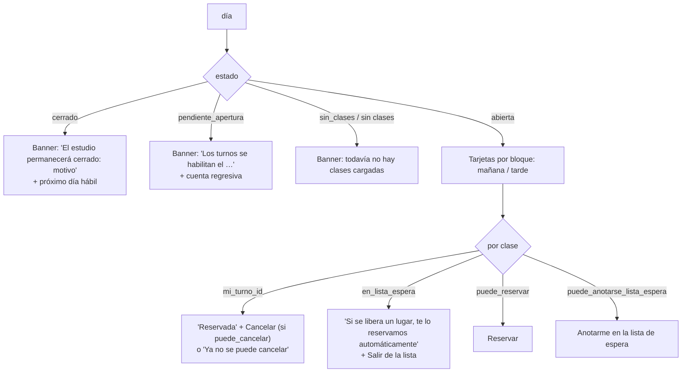
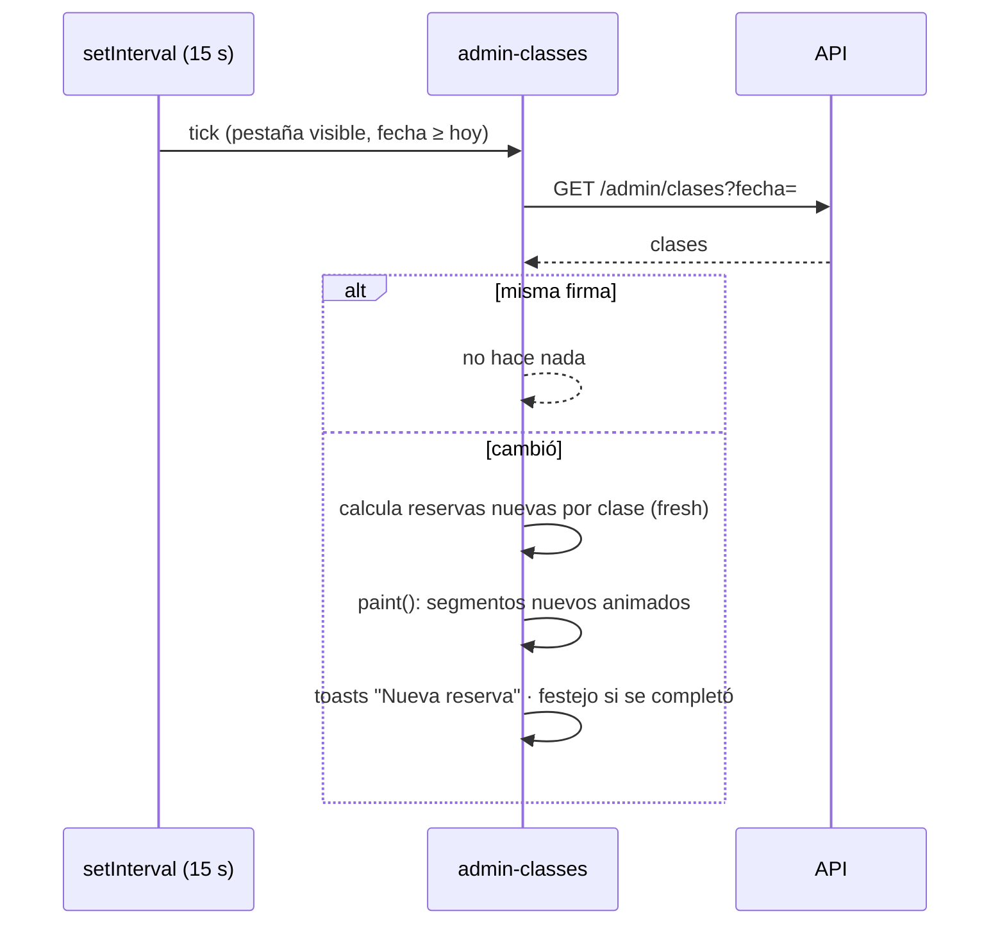

# Pilates Studio UI: documentación técnica

> Estado: octubre 2026 (commit `3f1b89b`).
> Alcance: el front `pilates-ui`. El backend está documentado en `py-pilates/doc/technical/TECH.md`.
> Los diagramas están en [Mermaid](https://mermaid.js.org/), que GitHub y la mayoría de los IDEs renderizan.

---

## Índice

1. [Visión general](#1-visión-general)
2. [Despliegue y ejecución](#2-despliegue-y-ejecución)
3. [Arquitectura del código](#3-arquitectura-del-código)
4. [Arranque y ciclo de render](#4-arranque-y-ciclo-de-render)
5. [Ruteo y control de acceso](#5-ruteo-y-control-de-acceso)
6. [Sesión y autenticación](#6-sesión-y-autenticación)
7. [Cliente HTTP y manejo de errores](#7-cliente-http-y-manejo-de-errores)
8. [Templates y seguridad contra XSS](#8-templates-y-seguridad-contra-xss)
9. [Componentes y utilidades de UI](#9-componentes-y-utilidades-de-ui)
10. [Pantallas del alumno](#10-pantallas-del-alumno)
11. [Pantallas de recepción (admin)](#11-pantallas-de-recepción-admin)
12. [Actualización en vivo (polling)](#12-actualización-en-vivo-polling)
13. [Estilos, temas y responsive](#13-estilos-temas-y-responsive)
14. [Accesibilidad](#14-accesibilidad)
15. [Mapa de endpoints usados](#15-mapa-de-endpoints-usados)
16. [Almacenamiento en el navegador](#16-almacenamiento-en-el-navegador)
17. [Seguridad](#17-seguridad)
18. [Cómo agregar una pantalla](#18-cómo-agregar-una-pantalla)
19. [Operación y problemas frecuentes](#19-operación-y-problemas-frecuentes)
20. [Limitaciones conocidas y mejoras posibles](#20-limitaciones-conocidas-y-mejoras-posibles)

---

## 1. Visión general

SPA (*single page application*) para alumnos y recepción del estudio:

- **Sin frameworks ni paso de build.** HTML, CSS y JavaScript vanilla con ES modules nativos. Lo que está en el repo es exactamente lo que se sirve.
- **Mobile first.** En el teléfono hay una barra de pestañas abajo; en escritorio, navegación arriba.
- **Lógica de negocio en el backend.** El front no replica reglas: decide qué botones mostrar a partir de los flags que manda la API (`puede_reservar`, `puede_cancelar`, `puede_anotarse_lista_espera`, `estado` del día). Si una acción igual falla, muestra el mensaje del backend.
- **Dos roles:**
  - **Alumno:** reserva, cancela, se anota en lista de espera, ve su historial y el calendario de cierres.
  - **Admin (recepción):** panel del día en vivo, asistencia, reservas y cancelaciones en nombre de alumnos, cierres y gestión de alumnos.

| Capa | Tecnología |
|---|---|
| Lenguaje | JavaScript ES2022 (módulos nativos, `async/await`, `?.`, `??`) |
| Vista | Templates propios con *tagged templates* y escape automático (`js/html.js`) |
| Estilos | Un solo CSS con *design tokens* en variables CSS, tema claro y oscuro |
| Gráficos | SVG (anillos de ocupación) y canvas (papel picado) generados a mano |
| Tipografía | Inter (texto) y Fraunces (títulos), servidas desde el mismo nginx (`fonts/`, licencia OFL) |
| Servidor | nginx 1.30 (Docker) o `scripts/dev_server.py` en desarrollo |

---

## 2. Despliegue y ejecución



### 2.1 Docker

```bash
docker compose up -d --build                                   # http://localhost:3000
API_URL=https://api.mi-estudio.com docker compose up -d --build # API en otro dominio
```

- **Imagen:** `nginx:1.30-alpine` (rama estable) con `apk upgrade` al construir. Copia `index.html`, `config.js`, `css/`, `js/` y `fonts/` a `/usr/share/nginx/html`.
- **`docker/40-write-config.sh`** corre al arrancar el contenedor y genera `config.js` y los encabezados de seguridad (`/etc/nginx/security-headers.inc`, con la CSP; ver [§17](#17-seguridad)):
  - Si `API_URL` está definida, la usa tal cual.
  - Si no, la API se busca en **el mismo host desde el que se abrió la página, puerto 8000**. Por eso funciona igual desde `localhost` que desde un teléfono en la red local (`http://192.168.0.2:3000` → API en `http://192.168.0.2:8000`).
- **`docker/nginx.conf`:**

  | Regla | Para qué |
  |---|---|
  | `location / { try_files $uri $uri/ /index.html; }` | *Fallback* de SPA: cualquier ruta (ej. `/mis-turnos`) devuelve `index.html` y el router del cliente decide |
  | `config.js` con `Cache-Control: no-store` | Se regenera en cada arranque; nunca cachearlo |
  | `*.css`, `*.js` con `Cache-Control: no-cache` | El navegador revalida en cada carga, así un deploy se ve enseguida sin versionar los archivos |
  | `gzip` para CSS, JS y SVG | Menos bytes |
  | `/fonts/` con `Cache-Control: public, max-age=2592000` | Las fuentes casi nunca cambian (30 días) |
  | `include /etc/nginx/security-headers.inc` | CSP, `X-Content-Type-Options`, `Referrer-Policy` y `X-Frame-Options: DENY`. Se incluye en el `server` y en cada `location` que define sus propios `add_header`, porque nginx no los hereda en ese caso |

### 2.2 Desarrollo sin Docker

```bash
python3 scripts/dev_server.py 3000
```

Es un servidor estático de la biblioteca estándar. Si la ruta pedida no existe, devuelve `index.html` (fallback de SPA). Manda `Cache-Control: no-store` para que cada cambio se vea al recargar.

### 2.3 Requisitos del lado del backend

- **`CORS_ORIGINS`** tiene que incluir el origen del front (ej. `http://localhost:3000,http://192.168.0.2:3000`).
- **`FRONTEND_URL`** tiene que apuntar a este front. Los links de los emails se resuelven acá: `/reset-password?token=…`, `/reservar` y `/clases/{id}`.

---

## 3. Arquitectura del código

```
index.html            Shell: topbar (desktop), tabbar (mobile), contenedor de toasts y <dialog>
config.js             URL de la API (runtime)
css/styles.css        Tokens, tema claro/oscuro, layout y componentes
css/fonts.css         @font-face de Inter y Fraunces (archivos en fonts/)
fonts/                Fuentes variables woff2 (latin y latin-ext) y sus licencias OFL
js/
├── app.js            Router (History API), guards por rol, chrome (navegación), arranque
├── api.js            Cliente fetch: base URL, JWT, errores {error, detail}, 401 → logout
├── session.js        Store reactivo de sesión (localStorage + suscriptores)
├── theme-init.js     Script clásico del <head>: aplica el tema antes de pintar
├── theme.js          Tema Sistema / Claro / Oscuro
├── html.js           Templates con escape automático (html``, raw, mount)
├── ui.js             Toasts, diálogo modal, estados de carga/vacío/error, delegación de eventos
├── format.js         Fechas en español, cuenta regresiva, iniciales
├── icons.js          Íconos SVG inline
├── components/
│   ├── month-calendar.js   Grilla mensual reutilizable
│   ├── ring.js             Anillo de ocupación (SVG)
│   └── confetti.js         Papel picado (canvas)
└── views/            Una vista por pantalla (+ auth-layout y admin-common compartidos)
```

### 3.1 Dependencias entre módulos



Reglas que mantiene el código:

- **`html.js` no depende de nada.** Todo lo que pinta HTML pasa por él.
- **`api.js` sólo conoce a `session.js`.** Las vistas nunca arman `fetch` a mano.
- **Las vistas no se importan entre sí.** Comparten código sólo por `auth-layout.js` (pantallas de autenticación) y `admin-common.js` (pantallas de admin).
- **Estado local por vista.** No hay un store global salvo la sesión. Cada vista guarda sus datos en variables de su `render` y se repinta llamando a su propio `paint()`.

### 3.2 Contrato de una vista

Cada archivo de `js/views/` exporta:

```js
export const title = "Reservar";             // va al <title> del documento

export function render(root, { navigate, params }) {
  // root: <section> vacía donde pintar
  // params: URLSearchParams de la URL actual
  // ...pinta, registra eventos con on(root, ...), carga datos...
  return () => { /* cleanup opcional: timers, listeners globales */ };
}
```

Patrón interno que siguen todas las vistas con datos:

```js
let data = null;                         // null = cargando
const paint = () => mount(root, html`…${data === null ? spinner() : …}`);
async function load() {
  try { data = await api.get("/…"); paint(); }
  catch (err) { mount(root, errorState(err)); }   // botón "Reintentar" → data-action="retry"
}
on(root, "click", "[data-action]", (el) => { /* switch por el.dataset.action */ });
paint(); load();
```

---

## 4. Arranque y ciclo de render



Puntos importantes:

- **El tema se aplica antes del primer pintado.** `js/theme-init.js`, un script clásico y bloqueante del `<head>`, lee `pilates.theme` y pone `data-theme`, así no hay destello claro en modo oscuro.
- **`render()` es idempotente.** Se llama al arrancar, en cada navegación, en `popstate` (atrás/adelante) y cada vez que cambia la sesión.
- **Cleanup.** Antes de pintar la vista nueva se ejecuta la función que devolvió la anterior. Así se cortan los timers de refresco de `/reservar` y `/admin/clases` al salir.
- **Errores no capturados de una vista** se muestran en un toast, sin romper la app.

---

## 5. Ruteo y control de acceso

Router propio con la History API (`js/app.js`). Los links internos llevan `data-link`. Un listener global intercepta el click y hace `pushState`, salvo que se use Ctrl, Cmd o Shift (abrir en otra pestaña).

| Ruta | Acceso | Vista |
|---|---|---|
| `/login` | `guest` | `login.js` |
| `/registro` | `guest` | `register.js` |
| `/olvide` | `guest` | `forgot.js` |
| `/reset-password?token=` | `any` | `reset.js` (también la usa el email de bienvenida) |
| `/reservar` | `user` | `book.js` |
| `/clases/{id}` | `user` | Alias de `/reservar` (link del email de lista de espera) |
| `/mis-turnos` | `user` | `my-bookings.js` |
| `/calendario` | `user` | `calendar.js` |
| `/admin/clases` | `admin` | `admin-classes.js` |
| `/admin/asistencia?fecha=&clase=` | `admin` | `admin-attendance.js` |
| `/admin/cierres` | `admin` | `admin-closures.js` |
| `/admin/usuarios` | `admin` | `admin-users.js` |



- **Los redirects usan `replaceState`**, para que "atrás" no vuelva a una pantalla prohibida.
- **`next` se valida** al loguearse (`auth-layout.js → enterApp`). Tiene que empezar con `/` y no con `//`, así no se puede usar para redirigir a otro sitio (*open redirect*).
- **Los guards son de experiencia de usuario, no de seguridad.** Quien autoriza es el backend: un alumno que fuerce `/admin/clases` vería la pantalla, pero todas sus llamadas responderían 403.

---

## 6. Sesión y autenticación

### 6.1 Store de sesión (`js/session.js`)

- **Estado:** `{ token, user }`, persistido en `localStorage` bajo la clave `pilates.session`.
- **Al cargar**, se descarta si el JWT ya venció. El front decodifica el `exp` del token sin verificar la firma, sólo para no arrancar con una sesión muerta.
- **API:**
  - Lectura: `session.user`, `session.token` y `session.isAdmin`.
  - Cambios: `session.login(auth)`, `session.update(user)` y `session.logout()`.
  - Reactividad: `session.subscribe(fn)`.
- **Reactividad:** `app.js` se suscribe y vuelve a renderizar en cada cambio. Si la sesión se pierde sin que el usuario haya tocado "Salir" (401 del backend), muestra el toast "Tu sesión expiró. Volvé a ingresar.".

### 6.2 Ciclo de vida



### 6.3 Flujos de autenticación

| Pantalla | Qué hace |
|---|---|
| Login | `POST /auth/login` y luego `enterApp()`: `replaceState(next)` + `session.login()`. El router re-renderiza en la ruta destino |
| Registro | Valida que las dos contraseñas coincidan, hace `POST /auth/register` y después login automático, que lleva a `/reservar` |
| Olvidé mi contraseña | `POST /auth/forgot-password`. Muestra el mensaje genérico del backend, que no revela si el email existe |
| Nueva contraseña | Lee `?token=` y hace `POST /auth/reset-password`. Sin token, muestra "Enlace inválido". La usan tanto la recuperación como el email de bienvenida de un alumno dado de alta por recepción |
| Salir | `POST /auth/logout`, que revoca la sesión de este dispositivo en el servidor. Pase lo que pase con esa llamada (`finally`), se borra la sesión local |

---

## 7. Cliente HTTP y manejo de errores

`js/api.js` expone `api.get(path, query)`, `api.post(path, body)`, `api.put`, `api.patch` y `api.del(path, query)`.



- **`ApiError`** tiene `status`, `code` (el `error` del backend, ej. `class_full`) y `message`.
- **El mensaje** sale de `detail`:
  - Si es un string, se usa tal cual. Son los errores de dominio, ya redactados en español por el backend.
  - Si es una lista, se arma `campo: mensaje` por cada error. Son los 422 de validación de Pydantic.
- **Rate limiting:** un 429 llega con `detail` del tipo "Demasiados intentos. Probá de nuevo en 15 minutos.", y login, registro y recuperación lo muestran tal cual.
- **Dónde se muestran los errores:**
  - Formularios de autenticación y diálogos: dentro del formulario (`[data-error]`). El diálogo no se cierra.
  - Acciones sueltas: toast de error (`toastError`).
  - Cargas de pantalla: banner "No pudimos cargar la información" con botón **Reintentar**.

---

## 8. Templates y seguridad contra XSS

`js/html.js` implementa un mini motor de templates con *tagged templates*:

```js
html`<p>Hola ${user.full_name}</p>`     // full_name se escapa: & < > " '
html`<ul>${items.map((i) => html`<li>${i}</li>`)}</ul>`  // arrays y anidados
raw(svgString)                           // marca HTML de confianza (sólo íconos y SVG propios)
mount(element, template)                 // element.innerHTML = render(template)
```

- **Todo valor interpolado se escapa**, salvo que sea un `SafeHtml`, es decir, salido de otro `` html`…` ``.
- **`null`, `undefined` y `false` no pintan nada.** Permite escribir `` ${cond ? html`…` : ""} ``.
- **`raw()` sólo se usa con contenido generado por el propio código:** íconos SVG (`icons.js`) y el cuerpo del anillo (`ring.js`). Nunca con datos de la API.
- **Textos de usuario fuera de templates:** los toasts y los errores de formulario usan `textContent`, que no interpreta HTML.

Así, un nombre como `` se muestra literal y no se ejecuta.

---

## 9. Componentes y utilidades de UI

### 9.1 `ui.js`

| Función | Qué hace |
|---|---|
| `toast(msg, type, ms)` | Aviso temporal (`info`, `success`, `error`) en `#toasts`, que tiene `aria-live="polite"` |
| `toastError(err)` | Toast de error con el mensaje de un `ApiError` |
| `withLoading(button, fn)` | Deshabilita el botón y le pone la clase `loading` mientras corre `fn`. Evita dobles clicks |
| `dialog({...})` | Modal genérico sobre `<dialog>`, con campos (`text`, `email`, `number`, `date`, `select`, `textarea` y `checkbox`). Ver abajo |
| `confirmDialog(opts)` | `dialog` que devuelve `true` o `false` |
| `spinner()`, `emptyState()`, `errorState()` | Estados de carga, vacío y error |
| `on(root, type, selector, handler)` | Delegación de eventos: un listener por vista sobre `root`, que sobrevive a los repintados |
| `formValues(form)` | `FormData` a objeto, con los strings recortados |
| `debounce(fn, ms)` | Para la búsqueda de alumnos |

**`dialog`** devuelve una Promise:

- Los valores del formulario, si se confirma.
- `{ action }`, si se elige la acción secundaria (ej. "Reabrir día").
- `null`, si se cancela o se presiona Esc.

Si se le pasa `onSubmit(values)`, el diálogo hace la llamada a la API con el botón en estado de carga. Si la llamada falla, el error aparece **dentro del diálogo** y el usuario puede corregir sin perder lo que escribió. En pantallas de menos de 480 px el diálogo se muestra como *bottom sheet*.

### 9.2 `components/`

| Componente | Descripción |
|---|---|
| `monthCalendar({year, month, renderDay})` | Grilla mensual de lunes a domingo. `renderDay(iso, {weekend, today})` decide la clase CSS, el contenido, si la celda es clickeable (`data-action="day"`) y el `title`. `monthState()` maneja la navegación entre meses y `monthRange()` devuelve `{desde, hasta}` para la API |
| `occupancyRing({value, capacity, fresh, muted, ...})` | Anillo SVG de ocupación. Con capacidad de hasta 12 dibuja **un segmento por lugar**, pintado con un degradé verde agua. Con más (ej. el total del día) dibuja un progreso continuo. `fresh` indica cuántos segmentos son nuevos, y esos se animan al aparecer |
| `confetti({force})` | Papel picado en un canvas a pantalla completa, con `pointer-events: none`, que se borra solo. Si el sistema pide reducir movimiento, usa una versión suave salvo `force` (click explícito) |

### 9.3 `format.js`

- **Fechas:** `parseDate("2026-10-13")` crea la fecha en **hora local** para que no se corra un día por la zona horaria. También están `toISODate`, `addDays` y `today()`.
- **Textos en español:**
  - `longDate` → "miércoles 21 de octubre".
  - `relativeDay` → "Hoy", "Mañana" o "Ayer".
  - `shortDay` → "mié".
  - `monthName`.
- **`countdown(iso)`** → "2 h 15 min", usado para la apertura de turnos. Devuelve `null` si ya pasó.
- **Otros:** `hhmm("08:00:00")` → "08:00", `dateTime`, `initials` (para los avatares) e `isWeekday`.

---

## 10. Pantallas del alumno

### 10.1 Reservar (`/reservar`, `book.js`)

Consume `GET /clases/disponibles`, que devuelve hoy y el próximo día hábil abierto (con los días cerrados intermedios). Cada día se pinta según su `estado`:



- **Lugares:** se muestran como puntitos (uno por lugar) y como texto ("2/4 lugares disponibles" o "Completa").
- **Hoy:** sólo se muestran las clases que todavía no empezaron, según la hora del navegador. Si no queda ninguna, el día de hoy no aparece.
- **Acciones:**

  | Botón | Llamada | Toast |
  |---|---|---|
  | Reservar | `POST /turnos` | "¡Reserva confirmada! Te enviamos un email." |
  | Cancelar turno | `POST /turnos/{id}/cancelar`, con confirmación | "Turno cancelado." |
  | Anotarme en la lista de espera | `POST /clases/{id}/lista-espera` | Explica que, si se libera un lugar, se lo reservamos y le avisamos por email |
  | Salir de la lista de espera | `DELETE /clases/{id}/lista-espera` | "Saliste de la lista de espera." |

  Después de cada acción se recarga la grilla en silencio. Si la acción falla (ej. `class_full` porque otro alumno ganó el lugar), se muestra el mensaje del backend.
- **En vivo:** se refresca cada 30 s y al volver a la pestaña (ver [§12](#12-actualización-en-vivo-polling)). Si llega la hora de apertura con la pantalla abierta, recarga sola a los 2 s.

### 10.2 Mis turnos (`/mis-turnos`, `my-bookings.js`)

- **Datos:** `GET /turnos/mios` devuelve `{proximas, pasadas}`. La pantalla tiene dos pestañas, con la cantidad de próximas en el título.
- **Cada turno muestra:**
  - Un *chip* con la fecha.
  - El horario y el instructor.
  - Una etiqueta de estado:

    | Estado | Etiqueta |
    |---|---|
    | `confirmada` | Confirmada |
    | `cancelada` | Cancelada |
    | `cancelada_por_admin` | Cancelada por el estudio |
    | `asistio` | Asististe |
    | `no_asistio` | Ausente |

  - El motivo de cancelación, si lo hay.
- **Cancelar** aparece sólo si el backend manda `puede_cancelar`.

### 10.3 Calendario (`/calendario`, `calendar.js`)

`GET /calendario?desde=&hasta=` del mes visible. Los días con cierre se marcan con la etiqueta del backend (ej. "Feriado - Sin clases"). Debajo del calendario se listan los días sin clases del mes con su motivo.

---

## 11. Pantallas de recepción (admin)

`admin-common.js` comparte entre estas pantallas:
- **Barra de fecha** (`dateBar`): ← día anterior, selector y día siguiente, saltando los fines de semana (`shiftWeekday`).
- **Etiquetas de estado de clase.**
- **Tipos de cierre** con sus nombres para mostrar.

### 11.1 Clases del día (`/admin/clases`, `admin-classes.js`)

Panel principal de recepción. Usa `GET /admin/clases?fecha=`.

- **Resumen del día:**
  - Un anillo grande con lo reservado sobre la capacidad total de las clases activas.
  - Ocupación en %.
  - Lugares libres.
  - Clases completas sobre clases activas.
  - Personas en lista de espera.
- **Una tarjeta por clase**, agrupadas en mañana y tarde:
  - Un anillo con un segmento por lugar.
  - Horario e instructor.
  - Cuántos hay en lista de espera.
  - El motivo, si la clase está cancelada.
- **Acciones por clase:**

  | Acción | Cuándo aparece | Llamada |
  |---|---|---|
  | Asistencia | Clase activa, con reservas, de hoy o de un día pasado | Link a `/admin/asistencia?fecha=…&clase=…` |
  | Editar (capacidad e instructor) | Siempre | `PATCH /admin/clases/{id}` |
  | Cancelar (motivo obligatorio) | Activa y todavía no empezó | `POST /admin/clases/{id}/cancelar` |
  | Reactivar | Cancelada y todavía no empezó | `POST /admin/clases/{id}/reactivar` |
  | Ver cierre | Cerrada por un cierre | Link a `/admin/cierres` |
  | Generar grilla (con opción de avisar por email) | Día hábil sin clases | `POST /admin/clases/generar` |

- **En vivo cada 15 s** (sólo hoy o días futuros):
  - Compara con lo que ya se mostraba.
  - Cada reserva nueva anima su segmento del anillo y muestra un toast "Nueva reserva · 09:00 hs (3/4)".
  - Si nada cambió, no repinta.
- **Festejo:** cuando una clase se completa, aparece papel picado y un toast.
  - Las clases ya festejadas se recuerdan en `localStorage` (`pilates.admin.celebrated`), así no se repite al recargar.
  - Si la clase se llenó mientras recepción no miraba, el festejo aparece al entrar.
  - Si se libera un lugar y se vuelve a llenar, se festeja de nuevo.
  - Un click en el anillo de una clase completa repite el festejo.

### 11.2 Asistencia (`/admin/asistencia`, `admin-attendance.js`)

`GET /admin/asistencia?fecha=` devuelve las clases del día, cada una con sus alumnos.

- **Marcar asistencia:** el selector "Asistió / Ausente" hace `POST /admin/turnos/{id}/asistencia`. La pantalla se actualiza localmente, sin recargar todo.
- **Agregar alumno** (si la clase está activa, no terminó y tiene lugar):
  1. Carga `GET /admin/usuarios?estado=activo&limit=200`.
  2. Filtra a los admins y a los que ya están anotados.
  3. Ofrece un selector y hace `POST /admin/turnos`.

  Recepción reserva sin ventana ni límites diarios: sólo cuenta el cupo.
- **Cancelar turno (✕):** aparece en turnos confirmados de clases que no terminaron. Pide un motivo opcional y hace `POST /admin/turnos/{id}/cancelar`. Al alumno le llega un email y el lugar pasa al primero de la lista de espera.
- **Link directo:** acepta `?fecha=AAAA-MM-DD&clase=<id>`, que hace scroll hasta la clase y la resalta. Es el botón Asistencia del panel de clases.

### 11.3 Cierres (`/admin/cierres`, `admin-closures.js`)

- **Calendario del mes:** usa `GET /admin/calendario`. Los días cerrados muestran su motivo y los hábiles la cantidad de reservas.
  - **Click en un día hábil futuro:** abre el alta del cierre con la fecha precargada.
  - **Click en un día cerrado:** abre la edición, que tiene la acción secundaria "Reabrir día".
- **Próximos cierres:** usa `GET /admin/cierres` para los próximos 365 días.
  - Los días hábiles consecutivos con el mismo tipo y motivo se **agrupan**. Por ejemplo, unas vacaciones de 10 días aparecen como un solo rango.
  - **Reabrir** borra todo el grupo de una vez (`DELETE /admin/cierres?desde=&hasta=`).
- **Nuevo cierre:** fecha desde, fecha hasta (opcional, para rangos), tipo y motivo. El motivo lo ven los alumnos. Hace `POST /admin/cierres`.
- **Mensajes de los diálogos:** explican las consecuencias. Al cerrar, se cancelan las reservas y se avisa. Al reabrir, se avisa a los afectados, pero el lugar no se les restaura.

### 11.4 Alumnos (`/admin/usuarios`, `admin-users.js`)

- **Listado:** `GET /admin/usuarios`, de a 50, con un botón "Cargar más".
- **Filtros:** búsqueda por nombre o email (con *debounce* de 350 ms) y estado (todos, activos o bloqueados).
- **Columnas:** reservas activas, asistencias y ausencias. En el teléfono la tabla se convierte en tarjetas (ver [§13](#13-estilos-temas-y-responsive)).
- **Acciones:**

  | Acción | Llamada | Notas |
  |---|---|---|
  | Nuevo alumno | `POST /admin/usuarios` | Le llega el email de bienvenida para definir su contraseña |
  | Bloquear | `POST /admin/usuarios/{id}/bloquear` | Con motivo |
  | Desbloquear | `POST /admin/usuarios/{id}/desbloquear` | — |

  A los admins no se les muestran acciones.

---

## 12. Actualización en vivo (polling)

No hay WebSockets: las pantallas que necesitan datos frescos consultan la API cada cierto tiempo.

| Pantalla | Intervalo | Cuándo | Detalles |
|---|---|---|---|
| `/reservar` | 30 s | Sólo con la pestaña visible, y además al volver a ella (`visibilitychange`) | Recarga en silencio: si falla, no muestra error |
| `/admin/clases` | 15 s | Pestaña visible y fecha de hoy o futura | Compara una firma (`id:reservados:lista_espera:status:capacidad`) y sólo repinta si cambió. Si el usuario cambia de día mientras carga, descarta la respuesta vieja |



Los timers se cortan en el *cleanup* de la vista al navegar a otra pantalla.

---

## 13. Estilos, temas y responsive

### 13.1 Tokens

`css/styles.css` define la paleta en variables CSS sobre `:root`: superficies, texto, primario (verde salvia), acento (terracota), estados (peligro, aviso, info), radios, sombras y tipografías. Los componentes sólo usan esas variables, nunca colores sueltos. Así, el tema oscuro redefine los tokens y ningún componente necesita reglas propias para él.

### 13.2 Tema claro, oscuro o sistema (`js/theme.js`)

- **Opciones:** el botón del menú de usuario (y el de las pantallas de autenticación) rota entre **Sistema → Claro → Oscuro**.
- **Guardado:** la preferencia se guarda en `localStorage` como `pilates.theme`. "Sistema" no guarda nada y sigue a `prefers-color-scheme`.
- **Aplicación:**
  - Se pone `data-theme="light|dark"` en `<html>` y `:root[data-theme="dark"]` redefine los tokens.
  - Se actualiza el `<meta name="theme-color">`, que es el color de la barra del navegador en el teléfono.
- **En vivo:** si la preferencia es "Sistema" y el sistema operativo cambia de modo, se actualiza sin recargar.
- **Antes del primer pintado:** `js/theme-init.js` aplica el tema, para evitar el destello. Es un archivo y no un script inline para que la CSP pueda prohibir los scripts inline.

### 13.3 Layout

| Ancho | Navegación | Otros |
|---|---|---|
| Menos de 768 px | Barra de pestañas fija abajo, con íconos y texto, que respeta `safe-area-inset` | Topbar compacta; los diálogos se muestran como *bottom sheet* (menos de 480 px) |
| 768 px o más | Navegación en la topbar con el nombre del usuario | Más padding; los toasts se desplazan |

- **Grillas:** `repeat(auto-fill, minmax(260px, 1fr))`, que ajusta las columnas solas.
- **Tablas:** se ven como tabla en escritorio y como tarjetas de menos de 720 px, usando `data-label` en cada celda.

---

## 14. Accesibilidad

- **Navegación:**
  - `<nav aria-label>` para la navegación principal.
  - `aria-current="page"` en la pestaña activa.
  - `<main tabindex="-1">` para el contenido.
- **Botones de ícono:** tienen `aria-label` o texto `sr-only` (ej. Salir, día anterior y siguiente, cancelar turno).
- **Anillos y barras de ocupación:** usan `role="img"` con `aria-label` ("3 de 4 lugares reservados").
- **Selector de asistencia:** `role="group"` y `aria-pressed` en cada opción.
- **Toasts:** en una región `role="status" aria-live="polite"`.
- **Diálogos:** el `<dialog>` nativo, con foco en el primer campo y cierre con Esc.
- **Movimiento:** `prefers-reduced-motion` desactiva las animaciones CSS y suaviza el papel picado.
- **Formularios:** validación nativa (`required`, `minlength`, `type="email"`) con `reportValidity()`, y `autocomplete` correcto para que los gestores de contraseñas funcionen.

---

## 15. Mapa de endpoints usados

| Pantalla / módulo | Endpoints |
|---|---|
| Login, registro, recuperación | `POST /auth/login`, `/auth/register`, `/auth/forgot-password`, `/auth/reset-password` |
| Salir (`app.js`) | `POST /auth/logout` |
| Reservar | `GET /clases/disponibles`, `POST /turnos`, `POST /turnos/{id}/cancelar`, `POST` y `DELETE /clases/{id}/lista-espera` |
| Mis turnos | `GET /turnos/mios`, `POST /turnos/{id}/cancelar` |
| Calendario | `GET /calendario` |
| Admin · Clases | `GET /admin/clases`, `POST /admin/clases/generar`, `PATCH /admin/clases/{id}`, `POST /admin/clases/{id}/cancelar`, `POST /admin/clases/{id}/reactivar` |
| Admin · Asistencia | `GET /admin/asistencia`, `POST /admin/turnos/{id}/asistencia`, `POST /admin/turnos`, `POST /admin/turnos/{id}/cancelar`, `GET /admin/usuarios` |
| Admin · Cierres | `GET /admin/calendario`, `GET`, `POST` y `DELETE /admin/cierres`, `PUT /admin/cierres/{id}` |
| Admin · Alumnos | `GET /admin/usuarios`, `POST /admin/usuarios`, `POST /admin/usuarios/{id}/bloquear` y `/desbloquear` |

`GET /auth/me` no se usa: el usuario llega en la respuesta del login y queda guardado en la sesión.

---

## 16. Almacenamiento en el navegador

| Clave (`localStorage`) | Contenido | Quién la usa |
|---|---|---|
| `pilates.session` | `{ token, user }` | `session.js` |
| `pilates.theme` | `light` o `dark`. No existe si se eligió "Sistema" | `theme.js` y `theme-init.js` |
| `pilates.admin.celebrated` | Ids de las clases ya festejadas (las últimas 300) | `admin-classes.js` |

Todos los accesos están dentro de `try/catch`. En modo privado o con el almacenamiento bloqueado, la app funciona igual, sólo que la sesión y el tema viven en memoria hasta que se cierra la pestaña.

---

## 17. Seguridad

- **XSS:** todo el HTML pasa por `` html`…` ``, que escapa por defecto (ver [§8](#8-templates-y-seguridad-contra-xss)). Los mensajes del backend se muestran con `textContent` o escapados.
- **Token:** se guarda en `localStorage` y se manda como `Authorization: Bearer`, sin cookies, así que no hay CSRF. El riesgo de guardarlo en `localStorage` es que un XSS podría leerlo; por eso importa el escape, y por eso el backend permite revocar sesiones.
- **Logout real:** "Salir" revoca la sesión en el servidor (`POST /auth/logout`), así que un token copiado deja de servir.
- **401 → logout:** si el backend revoca la sesión (logout desde la API, contraseña restablecida, cuenta bloqueada), la próxima llamada saca al usuario de la app.
- **Open redirect:** `next` sólo acepta rutas internas (`/…`, no `//…`).
- **Content-Security-Policy:** la genera `docker/40-write-config.sh` al arrancar, porque `connect-src` depende de `API_URL`:

  | Directiva | Valor | Por qué |
  |---|---|---|
  | `script-src` | `'self'` | Ni scripts inline ni de terceros: aunque se colara HTML, no se ejecuta código inyectado. Es la defensa principal |
  | `style-src` | `'self' 'unsafe-inline'` | Los templates usan atributos `style="…"` con valores calculados (anillos, barras de cupo) |
  | `connect-src` | `'self'` + el origen de `API_URL` | Sin `API_URL`: `http://*:8000 https://*:8000`, porque el host depende de desde dónde se abra (localhost, IP de la red) |
  | `font-src` / `img-src` | `'self'` / `'self' data:` | Fuentes locales; el favicon es un SVG `data:` |
  | `object-src`, `base-uri`, `form-action`, `frame-ancestors` | `'none'`, `'self'`, `'self'`, `'none'` | Sin plugins, sin `<base>` ajeno, formularios sólo al mismo origen, no se puede embeber |

  Se verifica sin herramientas: un `<script>` inline inyectado desde la consola no se ejecuta y dispara `securitypolicyviolation`.
- **Sin terceros:** las fuentes se sirven desde el mismo nginx, así que el navegador no le pide nada a otro dominio salvo a la API.
- **Encabezados de nginx:**
  - `X-Frame-Options: DENY`, que impide meter la app en un iframe (*clickjacking*).
  - `X-Content-Type-Options: nosniff`.
  - `Referrer-Policy: strict-origin-when-cross-origin`.
- **Autorización:** la decide siempre el backend. Los guards del router y los botones ocultos son sólo de experiencia de usuario.

---

## 18. Cómo agregar una pantalla

1. **Crear `js/views/mi-pantalla.js`** con `export const title` y `export function render(root, { params })`, siguiendo el patrón de [§3.2](#32-contrato-de-una-vista): `paint` + `load` + `on(root, …)`.
2. **Registrar la ruta** en `ROUTES` de `js/app.js`, con su `access` (`guest`, `any`, `user` o `admin`).
3. **Si va en la navegación**, agregarla a `NAV.alumno` o `NAV.admin`, con un ícono de `icons.js` (o agregar uno nuevo).
4. **Si usa timers o listeners globales**, devolver una función de cleanup desde `render`.
5. **Estilos:** usar los tokens y componentes existentes (`card`, `btn`, `badge`, `banner`, `grid`, `list`, `stack`). Si hace falta CSS nuevo, ponerlo en `styles.css` con variables, para que funcione en los dos temas.
6. **Probar** en el teléfono y en escritorio, en modo claro y oscuro.

---

## 19. Operación y problemas frecuentes

```bash
docker compose up -d --build        # reconstruir después de cambiar archivos (la imagen copia el código)
docker compose logs web             # muestra el apiUrl elegido al arrancar
```

| Síntoma | Causa / solución |
|---|---|
| "No se pudo conectar con el servidor." | La API no está arriba, `apiUrl` es incorrecta o CORS bloquea el origen. Revisar `docker compose logs web` (apiUrl) y `CORS_ORIGINS` del backend |
| Funciona en la PC pero no en el teléfono | Falta `http://<IP>:3000` en `CORS_ORIGINS` del backend |
| Los links de los emails abren `localhost` en el teléfono | `FRONTEND_URL` del backend apunta a localhost; poner la IP de la PC |
| Después de un deploy se ve la versión vieja | CSS y JS tienen `no-cache`, así que alcanza con recargar. Si sigue igual, revisar que se haya reconstruido la imagen (`--build`) |
| Me saca de la app de golpe | Un 401: el token venció (12 h), se cerró la sesión desde otro lado o se restableció la contraseña. Es lo esperado |
| "Demasiados intentos. Probá de nuevo en N minutos." | Rate limiting del backend en login, registro o recuperación |

---

## 20. Limitaciones conocidas y mejoras posibles

Ordenadas por impacto estimado.

1. **Sin tests automáticos del front.** Todo se prueba a mano o con verificaciones puntuales en el navegador. *Mejora:* algunas pruebas end-to-end con Playwright de los flujos críticos (login, reservar y cancelar, panel del admin) contra el stack de Docker.
2. **"Agregar alumno" carga hasta 200 alumnos activos.** Con más alumnos, los que quedan afuera no aparecen en el selector. *Mejora:* un selector con búsqueda que use `GET /admin/usuarios?search=`.
3. **Hora del navegador.** Algunas decisiones visuales usan el reloj y la zona del dispositivo: ocultar las clases de hoy que ya empezaron, y mostrar u ocultar Cancelar/Reactivar y los botones de asistencia (`hasStarted`, `hasEnded`). Con un reloj o una zona horaria distintos al del estudio, un botón puede aparecer o desaparecer antes de tiempo. El backend igual valida y responde con el error correspondiente. *Mejora:* que la API devuelva esos flags o la hora del servidor.
4. **Polling en lugar de push.** 30 s (alumno) y 15 s (admin) alcanzan para el volumen del estudio, pero hay un retraso y consultas aunque no cambie nada. *Mejora:* Server-Sent Events desde el backend si el volumen crece.
5. **`style-src 'unsafe-inline'` en la CSP.** Los templates usan atributos `style` con valores calculados. Un estilo inyectado no ejecuta código, pero podría desfigurar la página. *Mejora:* pasar esos valores por clases o por CSSOM (`el.style.width = …`, que la CSP permite) y sacar `'unsafe-inline'`.
6. **Sin modo offline ni PWA.** No hay *service worker* ni manifiesto, así que no se puede "instalar" en el teléfono ni ver los turnos sin conexión. *Mejora:* un manifiesto con un service worker que cachee el shell y la última respuesta de "Mis turnos".
7. **Mensaje genérico al perder la sesión.** Cualquier 401 muestra "Tu sesión expiró", aunque la causa sea una sesión revocada (contraseña restablecida o cuenta bloqueada). *Mejora:* distinguir por `ApiError.code` (`session_revoked`).
8. **Sin versionado de assets.** Se resolvió con `Cache-Control: no-cache`, que obliga a revalidar en cada carga. Con muchos usuarios convendría poner un hash en los nombres de archivo y cachear por mucho tiempo, pero eso requiere un paso de build.
